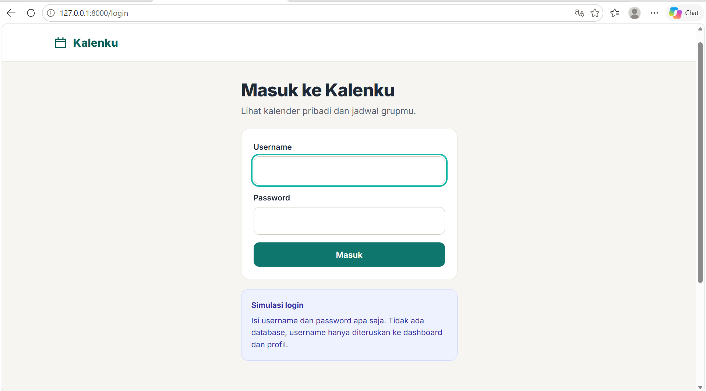
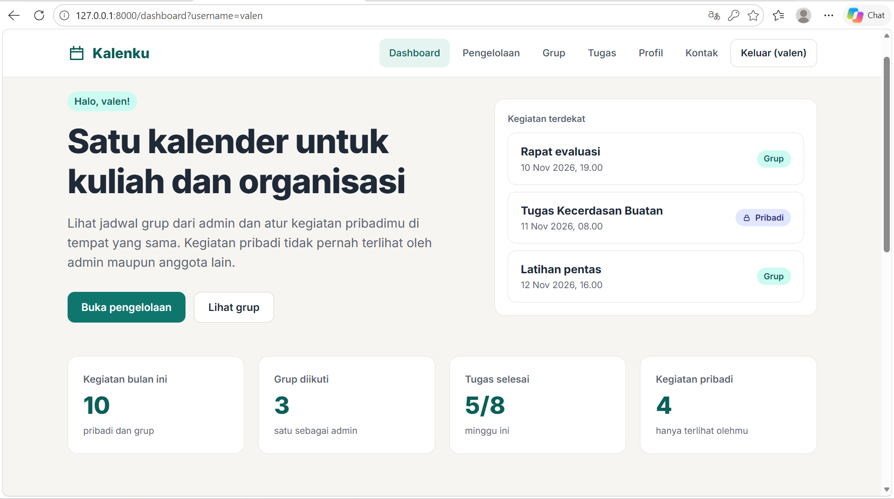
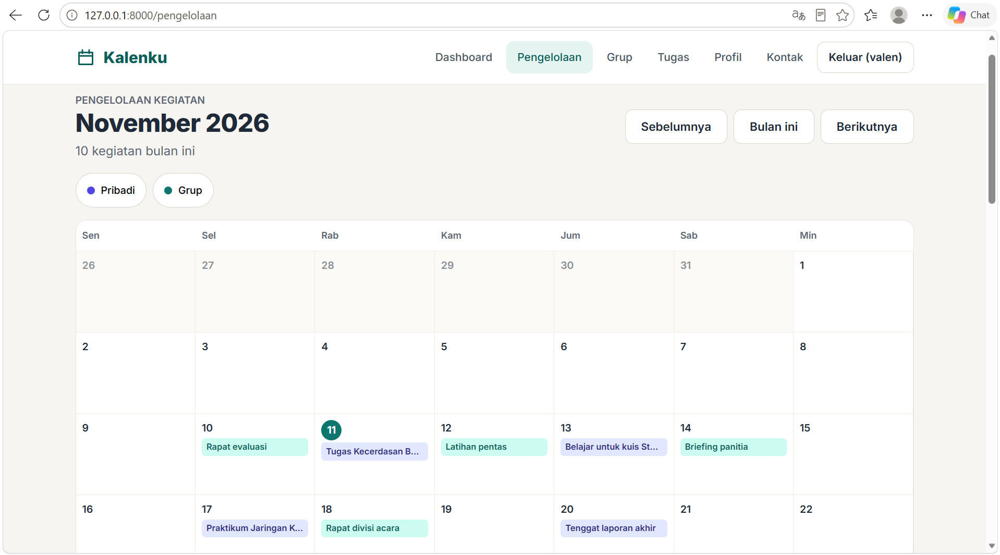
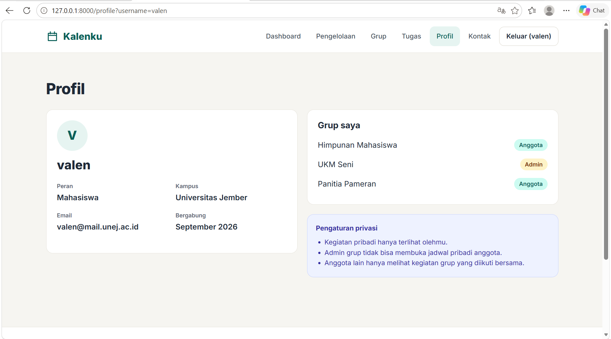

# Kalenku

Aplikasi web pengelolaan kegiatan organisasi berbasis kalender, dibuat dengan Laravel murni untuk UTS Pemrograman Web 2026.

- **Nama:** Valen
- **NIM:** 252410102029
- **Tema pengelolaan:** pengelolaan kegiatan pribadi dan kegiatan grup organisasi

## Penjelasan singkat

Kalenku menampilkan kegiatan pribadi dan kegiatan grup dalam satu kalender. Kegiatan grup dibuat oleh admin grup dan tampil untuk semua anggota, sedangkan kegiatan pribadi hanya terlihat oleh pemiliknya. Aplikasi ini tidak memakai database dan tidak memiliki CRUD, semua data berupa array di `PageController`.

Alur: **Login → Dashboard → Profil → Pengelolaan**. Username dari form login dikirim ke Dashboard dan Profil lewat request parameter (`?username=...`).

## Halaman

| Halaman | Route | Isi |
|---|---|---|
| Login | `/login` | Form username dan password (simulasi) |
| Dashboard | `/dashboard` | Sapaan username, statistik, kegiatan terdekat, grup |
| Pengelolaan | `/pengelolaan` | Kalender bulanan dan daftar kegiatan |
| Detail kegiatan | `/pengelolaan/kegiatan/{id}` | Detail satu kegiatan |
| Grup | `/grup`, `/grup/{slug}` | Daftar grup, anggota, dan kegiatan grup |
| Tugas | `/tugas` | Daftar tugas dengan progres |
| Profil | `/profile` | Data pengguna dan pengaturan privasi |
| Kontak | `/kontak` | Informasi kontak, FAQ, form simulasi |

## Struktur file utama

```
routes/web.php
app/Http/Controllers/PageController.php
app/Http/Middleware/CekLogin.php
resources/views/layouts/app.blade.php
resources/views/login.blade.php
resources/views/dashboard.blade.php
resources/views/pengelolaan.blade.php
resources/views/profile.blade.php
resources/views/components/navbar.blade.php
resources/views/components/footer.blade.php
resources/views/partials/ (dipanggil dengan @include)
public/css/app.css
public/js/app.js
```

## Cara menjalankan

```
composer install
copy .env.example .env
php artisan key:generate
php artisan serve
```

Buka `http://127.0.0.1:8000`. Pastikan `SESSION_DRIVER=file` dan `CACHE_STORE=file` di file `.env`.

## Screenshot

Login



Dashboard



Pengelolaan



Profil


